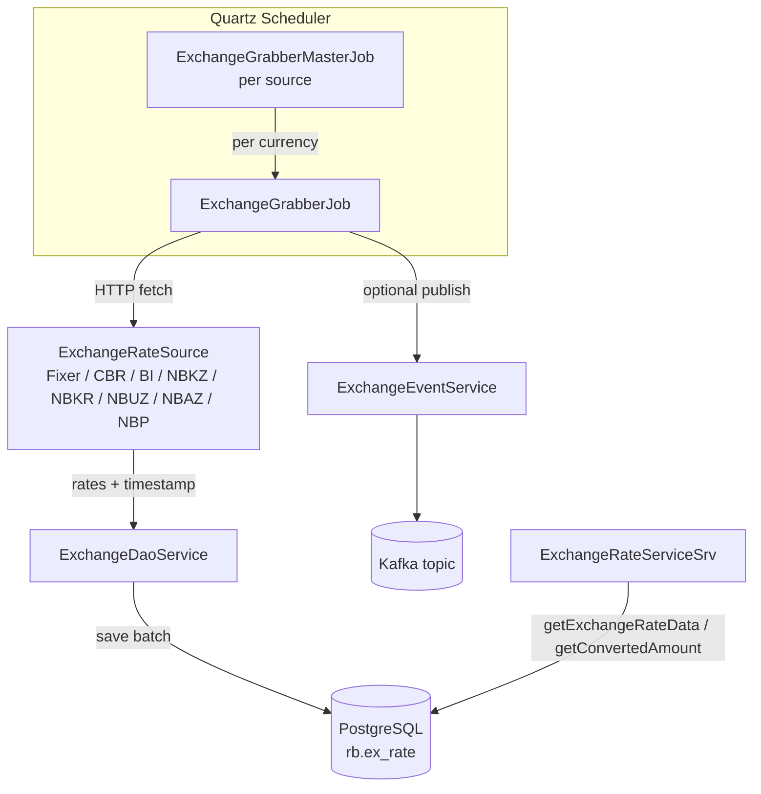

# rate-boss

Rate-boss periodically pulls exchange rates from external sources, stores them in the database, and optionally publishes rate events to Kafka. It also exposes API endpoints to read the latest or historical rates and to convert amounts by timestamp.

Supported sources today: Fixer, CBR, BI, NBKZ, NBKR, NBUZ, NBAZ, NBP.

## Service flow (actual)

## Quartz execution

For each configured source:
- `ExchangeGrabberMasterJob` reads the list of base currencies from `rates.*Job.currencies`.
- It spawns `ExchangeGrabberJob` per currency.
- Each `ExchangeGrabberJob` calls the respective `ExchangeRateSource`, saves the rates, and (for some sources) emits Kafka events.

## BI source notes

- Source: Bank Indonesia
- Stored BI rate format: `target currency per 1000 IDR` (e.g. `USD per 1000 IDR`), i.e. `1000 / (jual_subkurslokal / nil_subkurslokal)`.

## NBP source notes

- Source: Narodowy Bank Polski, source ID `nbp`.
- Endpoint: `GET https://api.nbp.pl/api/exchangerates/rates/A/EUR/?format=json` (configurable through `rates.source.nbp.rootUrl`).
- Stored pair: PLN → EUR, calculated as an exact rational `1 / mid`, without decimal rounding (e.g. `mid = 4.25` becomes `4/17`).
- The service applies the latest published quote to the polling day in `rates.source.nbp.timeZone` (`Europe/Warsaw` by default), stored at `00:00:00 UTC`. The bank's `effectiveDate` is validated and logged separately.
- NBP publishes table A on working days between 11:45 and 12:15. The current-rate endpoint returns the last published quote, so a Saturday request normally returns Friday's quote with Friday's `effectiveDate`, or an earlier date if Friday was a holiday. The `/today/` endpoint would return 404 when no quote was published that day; the service does not use it. See the [NBP API documentation](https://api.nbp.pl/en.html) and [publication schedule](https://nbp.pl/statystyka-i-sprawozdawczosc/kursy/informacja-o-terminach-publikacji-kursow-walut/).
- Both service APIs keep exact-day lookup: Saturday requests work after Saturday's polling has saved a quote. Missed polling days are not backfilled automatically.
- All HTTP clients share one `RestTemplate`, configured through `rates.http.connectTimeout` (default `5s`) and `rates.http.readTimeout` (default `15s`); both must be between `1ms` and `2147483647ms`. Replace the former `rates.source.nbp.connectTimeout` and `rates.source.nbp.readTimeout` keys with these shared settings. Failed requests use the existing retry policy.
- Rates are fetched at startup and hourly through `rates.nbpJob`; they are saved to the database without publishing Kafka events.
- The API and database retain signed 64-bit rational components. A converted result outside that range fails explicitly instead of silently truncating or changing sign. Existing stored quotes are not recalculated.
